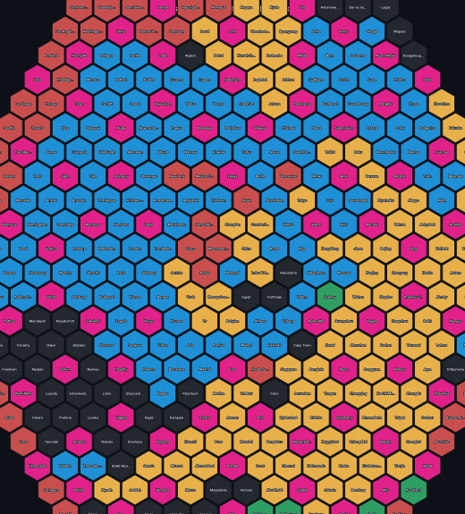
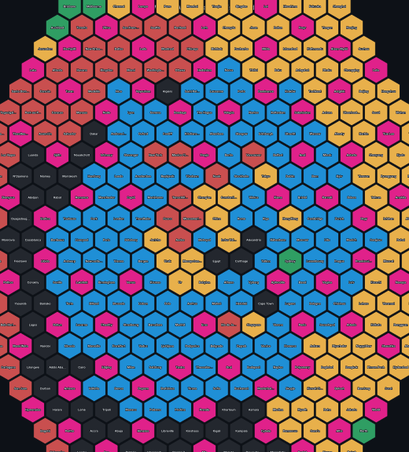
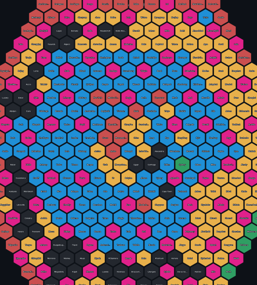
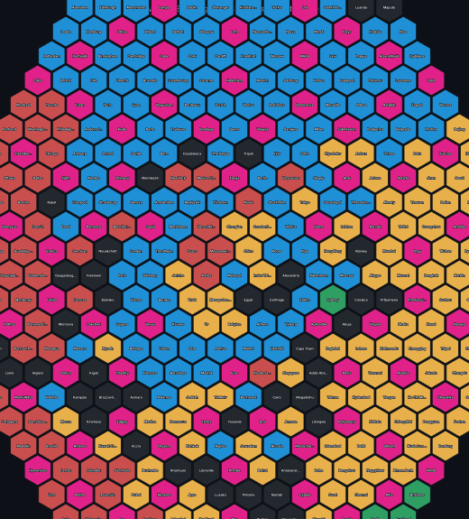
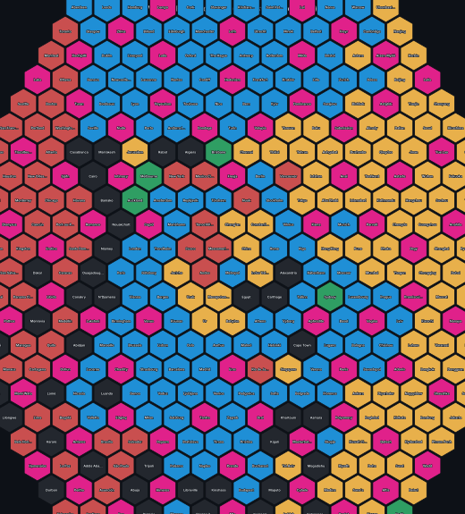
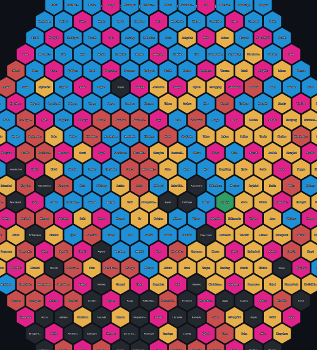
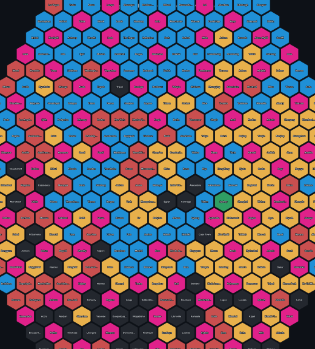

# v3.0 engine comparison — Variant A vs Variant B vs the v2.2 baseline

Sigurd's eye decides. **Variant A is what shipped in v3.0** (his ruling: "ship variant A — the modes run themselves"); Variant B and the v2.2 look are rendered here side by side so he can compare and switch later if he prefers another.

All panels: the shipped view (rings 0–11), pointy-side-up, continent colours (Europe blue, Asia yellow, Africa black, Americas red, Oceania green, the pink free-use districts pink).

## The metrics

Median = median real great-circle km between cities on adjacent hexes (the outer city; lower = real neighbours sit together). corr(lat, y) = latitude vs screen-height correlation (positive = north reads up). corr(lon, x) = longitude vs screen-width correlation (positive = east reads right).

| Panel | Median grid-neighbour km | corr(lat, y) | corr(lon, x) |
|---|---|---|---|
| **A · neighbours (shipped default)** | **1,330** | **+0.54** | **+0.53** |
| **A · hexagonal (shipped)** | **1,409** | **+0.30** | **+0.72** |
| **A · reverse (shipped, new mode 3)** | **2,316** | **+0.44** | **+0.56** |
| B · neighbours (local-swap after-step) | 1,678 | +0.71 | +0.83 |
| B · hexagonal (local-swap after-step) | 1,486 | +0.57 | +0.83 |
| v2.2 · neighbours (global re-sort, the old approved baseline) | 4,847 | +0.83 | +0.35 |
| v2.2 · hexagonal (global re-sort) | 4,917 | +0.85 | +0.38 |
| v2.0 reference (pure city-to-city, no compass) | 1,190 | +0.08 | +0.36 |

Read: the v2.2 re-sort bought a strong compass (corr 0.83) at the cost of adjacency (median 4,847 km — real neighbours torn apart). Variant A gets most of the compass back (0.54) while keeping v2.0-class adjacency (1,330 km). Variant B (greedy + local swaps within a small on-screen radius) scores best on paper (1,678 km, corr 0.71) — but it is an after-step, the thing Sigurd never asked for; A is the modes running themselves. His eye picks.

## The renders

### Variant A — the modes run themselves (SHIPPED)

| Neighbours (default) | Hexagonal | Reverse fill (new) |
|---|---|---|
|  |  |  |

### Variant B — greedy + local-swap after-step (not shipped)

| Neighbours | Hexagonal |
|---|---|
|  |  |

### v2.2 — global re-sort (the old approved baseline)

| Neighbours | Hexagonal |
|---|---|
|  |  |

The renders were generated headlessly from each engine's actual seating (the shipped tables for A, the saved v2.2 snapshot, and a scratch B build) — the same data the live page shows.
